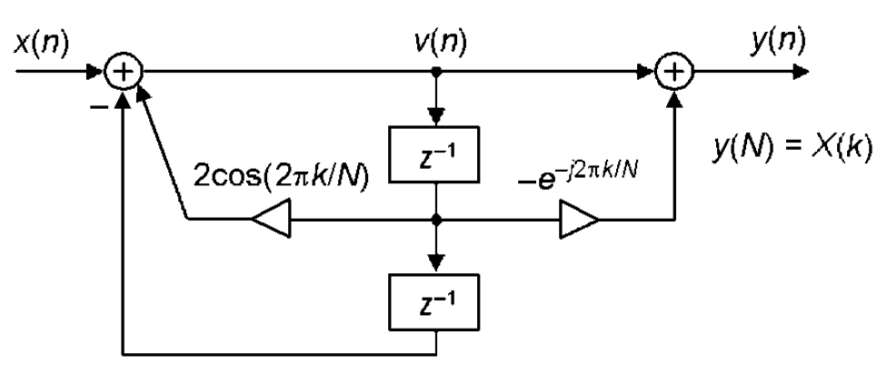

# Fixed-Point Goertzel Algorithm (Q1.15) — Verilog + MATLAB

A single-bin **Goertzel algorithm** (efficient DFT for one target frequency) implemented in fixed-point Verilog, with a testbench and a bit-accurate MATLAB model of the same arithmetic. The Goertzel algorithm detects the energy of a signal at one specific frequency bin `k` out of `N` samples, without computing a full FFT — useful for tone detection (e.g. DTMF, single-carrier power measurement).

## Files

| File | Description |
|---|---|
| RTL | `goertzel_q15` — the fixed-point Goertzel core |
| Testbench | `tb_goertzel_q15` — applies two test tones and prints the results |
| MATLAB | Bit-accurate model of the RTL + a reference frame-processing function |

## Assignment / Algorithm Specification

The algorithm and block diagram given in the assignment:

where `w = 2*pi*k/N` and `k` is the target frequency bin. `|X|` (or `|X|^2`) measures how much energy the input has at bin `k`.

## Fixed-Point Formats

| Signal | Format | Range |
|---|---|---|
| `x_in`, `v1`, `v2`, `X_re`, `X_im` | Q1.15 (16-bit signed) | -1 to 0.99997 |
| `COEFF_2COS` (i.e. `2*cos(w)`) | Q2.14 (16-bit signed) | -2 to 1.99994 (needs 2 integer bits since `2*cos(w)` can reach ±2) |
| `COS_W`, `SIN_W` | Q1.15 | -1 to 0.99997 |
| Recursion state `v1`, `v2` inside the core | 32-bit signed | extra headroom for the running sum |

Two multiply helpers handle the different formats:

- `mul_q214_q115_to_q115`: Q2.14 x Q1.15 -> shift right 14 -> Q?.15 (used for the feedback term `2*cos(w) * v[n-1]`).
- `mul_q115_q115_to_q115`: Q1.15 x Q1.15 -> shift right 15 -> Q?.15 (used for `cos(w)*v[N-2]` and `sin(w)*v[N-2]`).

Both shifts are **arithmetic** (`>>>`), i.e. truncation toward minus infinity, not rounding.

## RTL (`goertzel_q15`)

### Ports

| Port | Dir | Width | Description |
|---|---|---|---|
| `clk` | input | 1 | Clock |
| `rst_n` | input | 1 | Synchronous, active-low reset |
| `start` | input | 1 | Starts a new frame: clears `v1`, `v2`, sample counter |
| `in_valid` | input | 1 | Current `x_in` sample is valid (only sampled while `active`) |
| `x_in` | input | 16 (signed) | Input sample, Q1.15 |
| `out_valid` | output | 1 | Pulses for one cycle when `X_re`/`X_im` are ready |
| `X_re`, `X_im` | output | 16 (signed) | Real / imaginary part of the result, Q1.15 |

### Parameters

| Parameter | Description |
|---|---|
| `N_SAMPLES` | Frame length `N` (default 256) |
| `COEFF_2COS` | `2*cos(2*pi*k/N)` in Q2.14 |
| `COS_W`, `SIN_W` | `cos(2*pi*k/N)`, `sin(2*pi*k/N)` in Q1.15 |

The target bin `k` is baked into these three constants at instantiation time — the core does not compute cosines itself.

### Behavior

1. `start` resets the internal state (`v1 = v2 = 0`, `count = 0`) and sets `active`.
2. While `active` and `in_valid`, each cycle computes `v0 = x + 2cos(w)*v1 - v2` and shifts the state (`v2 <= v1; v1 <= v0`).
3. On the sample where `count == N_SAMPLES-1`, instead of just shifting state, the core also computes `X_re = v0 - cos(w)*v1` and `X_im = sin(w)*v1` (using the **not-yet-updated** `v1`, which at this point holds `v[N-2]`, together with the freshly computed `v0 = v[N-1]`), raises `out_valid` for one cycle, and clears `active`.
4. The core is idle until the next `start`.

### Timing

- Latency: the result appears on the same clock edge that processes the `N`-th valid sample (no extra pipeline delay after the last sample).
- Throughput: one input sample per clock while a frame is running; a new frame can only begin after `start`.
- Truncation, not saturation: unlike a saturating design, `trunc16` simply keeps the low 16 bits of the 32-bit result. If the true result does not fit in Q1.15 it silently wraps instead of clamping — see Notes.

## Testbench (`tb_goertzel_q15`)

- Instantiates the core for **`N = 256`, `k = 16`**, with coefficients precomputed as Verilog literals (`COEFF_2COS = 16'h7642`, `COS_W = 16'h7642`, `SIN_W = 16'h30FC`).
- `make_sine_q15(n, k_in)` generates a Q1.15 sine sample `0.7*sin(2*pi*k_in*n/N)` for a chosen input tone frequency `k_in`.
- `send_frame(kfreq)` pulses `start`, then streams `N_SAMPLES` sine samples at frequency bin `kfreq`, one per clock (on `negedge clk`), then drops `in_valid`.
- **Frame 1:** input tone at `k_in = 16` — matches the bin the core is tuned for, so the detected energy should be large.
- **Frame 2:** input tone at `k_in = 20` — off the tuned bin, so the detected energy should be much smaller.
- After each frame, `wait_outvalid` blocks until `out_valid` pulses, and an `always` block prints `X_re`/`X_im` in hex and as real numbers whenever `out_valid` is high.

### Expected Result

Reproducing the exact fixed-point arithmetic for this testbench:

| Input tone `k_in` | `X_re` (Q1.15) | `X_im` (Q1.15) | \|X\| |
|---|---|---|---|
| 16 (on target bin) | -0.554 | -0.679 | **0.877** |
| 20 (off target bin) | -0.0098 | -0.0233 | **0.025** |

The on-bin magnitude is about **35x** larger than the off-bin one, which is the expected Goertzel behavior: energy at the target frequency stands out sharply from energy elsewhere.

## MATLAB Model

The MATLAB script is a **bit-accurate reference** of the same fixed-point arithmetic, used to precompute the RTL coefficients and to cross-check the RTL's numeric output without running a simulator.

- `q15(x)`, `q214(x)`: quantize a real value to Q1.15 / Q2.14 (round to nearest, saturate).
- `ashr(x, sh)`: arithmetic right shift on `int32`/`int64`, matching Verilog's `>>>`.
- `mul_q214_q115_to_q115`, `mul_q115_q115_to_q115`: same two multiply-and-shift helpers as the RTL.
- `goertzel_frame_fixed(...)`: runs the `N`-sample recursion and final combine step exactly like the RTL, and returns both the raw Q1.15 output codes and their real-valued (`/2^15`) equivalents.
- The script computes `COEFF_2COS`, `COS_W`, `SIN_W` for `k_target = 16`, `N = 256` and prints them as hex — these are the literals used in the testbench (`0x7642`, `0x7642`, `0x30FC`).
- It then runs two frames (`k_in = 16` and `k_in = 20`, same 0.7-amplitude sine as the testbench) and prints `X_re`, `X_im`, and the magnitude ratio between the two frames, which should match the RTL simulation.

### How to Run

Run the script in MATLAB (or GNU Octave with the Fixed-Point-free integer functions used here — no toolbox required, only base `int16`/`int32`/`int64` and `bitsra`).

## Notes and Possible Improvements

- **No saturation on the final result:** `trunc16` (RTL) and the `bitand(...,65535)` step (MATLAB) both just keep the low 16 bits. With the coefficient magnitudes used here (`|COEFF_2COS| <= 2`, `|COS_W|, |SIN_W| <= 1`) the internal values stay well inside the 32-bit accumulator's range for a 256-sample frame, so this does not overflow in the tested cases — but nothing prevents a wrap-around for a longer frame or a larger input amplitude. Adding a `sat32to16` step (as in the AGC design) would make this safe.
- **Truncating shifts:** both multiply helpers truncate toward minus infinity (`>>> `) rather than round, which introduces a small consistent bias; add a rounding constant before the shift if better accuracy is needed.
- **Coefficients are precomputed, not generated on-chip:** `COEFF_2COS`, `COS_W`, `SIN_W` must be supplied per target bin `k`; the MATLAB script is the tool used to generate them.
- **One frame at a time:** the core cannot start a new frame while `active` is high; `start` during an active frame restarts it.
- The RTL's `v1` (used in the final-sample combine, before the state shift) corresponds exactly to the MATLAB script's post-loop `v2`, and the RTL's `v0` corresponds to the MATLAB script's post-loop `v1` — both compute the same `X_re = v[N-1] - cos(w)*v[N-2]`, `X_im = sin(w)*v[N-2]`, just at different points in the iteration.

## Tools

- Verilog (2001), simulated with Xilinx ISim or Vivado Simulator
- MATLAB (or Octave) for the reference model and coefficient generation
